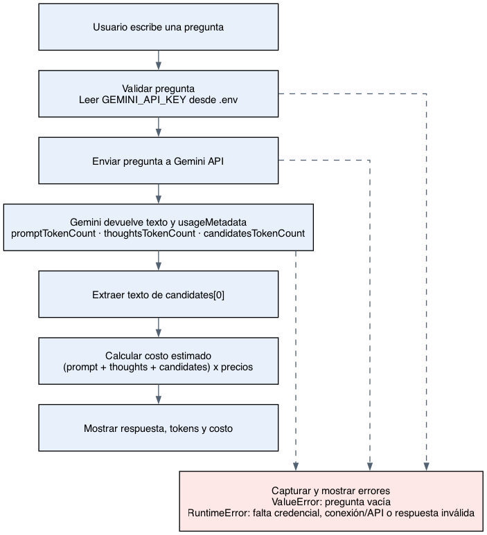

# Decisión de arquitectura: elección de modelo

## Modelo elegido

Deepseek 4.1 Flash (`deepseek/deepseek-v4.1-flash`)

## Diagrama de arquitectura

## Comparación de candidatos

Precios en USD por millón de tokens (entrada / salida). Los de Gemini y Deepseek vienen de OpenRouter (consultados el 2026-10-21) y los de Minimax, de la página oficial de MiniMax. La latencia sale de la prueba medida más abajo y las modalidades de entrada, de la ficha de cada modelo en OpenRouter.

| Criterio | Gemini 3.6 Flash | Deepseek 4.1 Flash | Minimax 3.1 Flash |
|---|---|---|---|
| Precio | $0.75 / $3.75 | $0.0342 / $0.1368 | $0.15 / $0.60 |
| Latencia | 7.21 s | 18.26 s | 12.26 s |
| Entrada (modalidades) | Texto, imagen, audio, video y archivos | Texto e imagen | Texto, imagen y video |
| Contexto | 1,048,576 tokens | 1,048,576 tokens | 1,000,000 tokens |

### Prueba medida

Se corrió la misma pregunta en los tres scripts de `src/`, midiendo tokens usados, costo y latencia: "Como se llega de santiago a mendoza. Explicalo en un breve resumen."

| Dato | Gemini 3.6 Flash | Deepseek 4.1 Flash | Minimax 3.1 Flash |
|---|---|---|---|
| Tokens de entrada | 18 | 50 | 220 |
| Tokens de salida | 265 | 1819 | 594 |
| Tokens de pensamiento | 741 | No informado | No informado |
| Costo de la llamada | $0.003786 | $0.000251 | $0.000389 |
| Latencia | 7.21 s | 18.26 s | 12.26 s |

Captura de la prueba:

Fue una sola ejecución por modelo, así que sirve como referencia y no como promedio.

## Justificación

La elección es **Deepseek 4.1 Flash**, y el motivo es el costo. Tiene la mayor latencia de los tres (18.26 s), pero el ahorro por llamada pesa más.

- **Costo (el criterio que decide):** en la prueba, Deepseek costó $0.000251 por llamada. Gemini costó unas 15 veces más ($0.003786) y Minimax unas 1.5 veces más ($0.000389).
- **Latencia (el costo de esta elección):** Deepseek fue el más lento con 18.26 s, unas 2.5 veces lo que tardó Gemini (7.21 s). Minimax quedó en el medio con 12.26 s.
- **Entrada:** Gemini es el más completo (texto, imagen, audio, video y archivos), Minimax acepta texto, imagen y video, y Deepseek texto e imagen. Este caso solo envía texto, así que no se requieren esas modalidades y el criterio no pesa en contra de Deepseek.
- **Contexto:** los tres tienen alrededor de 1M de tokens, así que no desempata.

## Alternativas descartadas y por qué

- **Gemini 3.6 Flash:** es el más rápido (7.21 s) y el que acepta más tipos de entrada, pero cuesta unas 15 veces más por llamada que Deepseek. Este caso solo usa texto, así que esa ventaja no compensa el costo. Se descarta por costo.
- **Minimax 3.1 Flash:** responde más rápido que Deepseek (12.26 s contra 18.26 s), pero cuesta unas 1.5 veces más por llamada ($0.000389 contra $0.000251) y no se considera gratis para este caso. Se descarta por costo; es la alternativa a reconsiderar si la latencia de Deepseek resulta demasiado alta.
